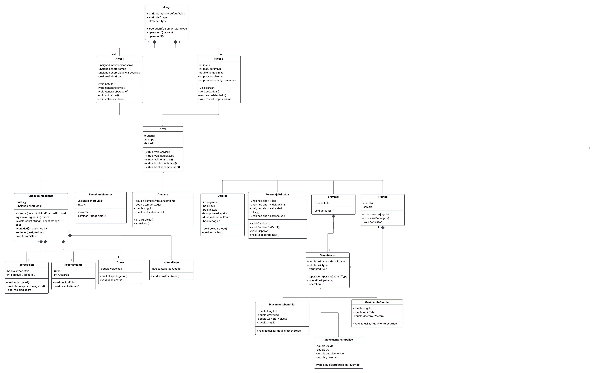
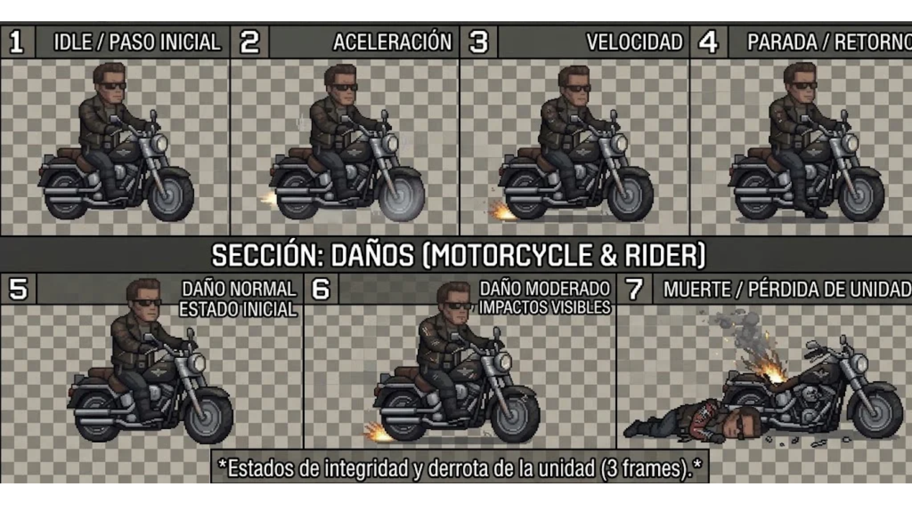
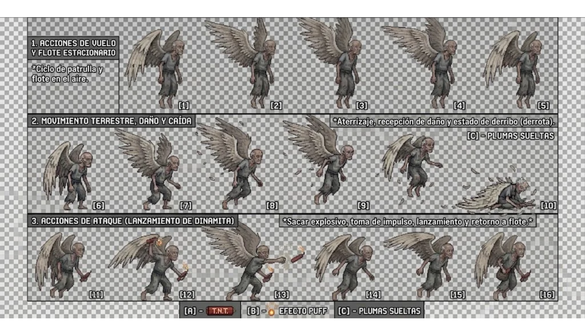
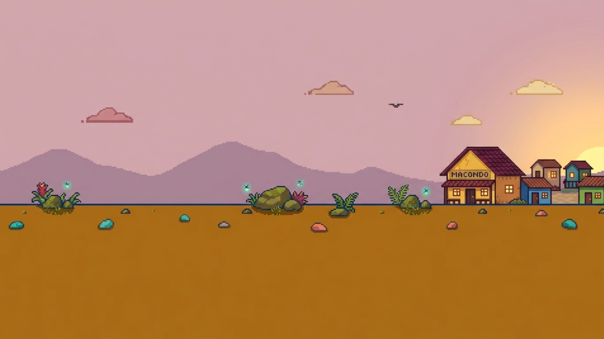
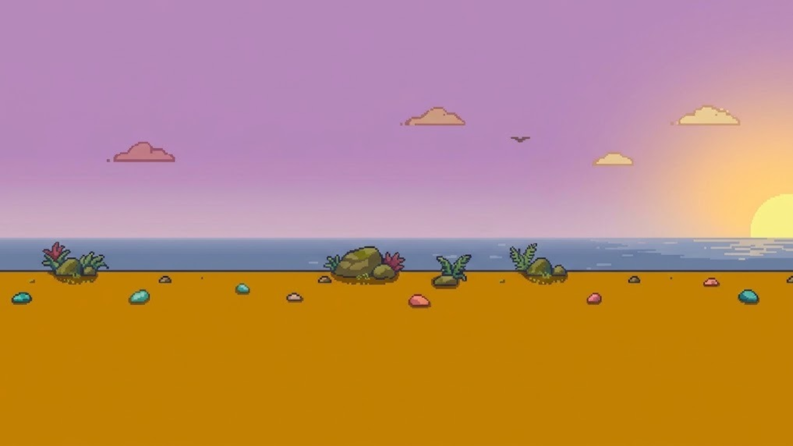
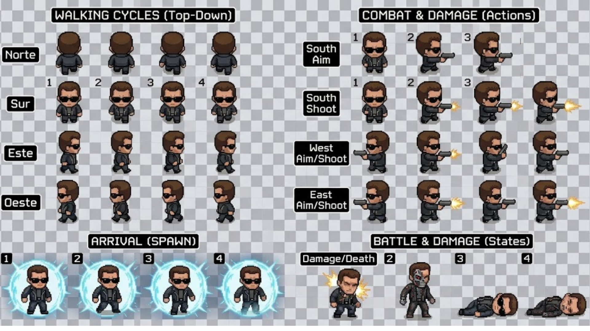
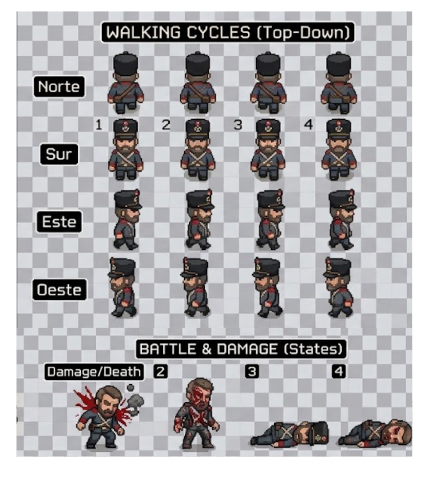
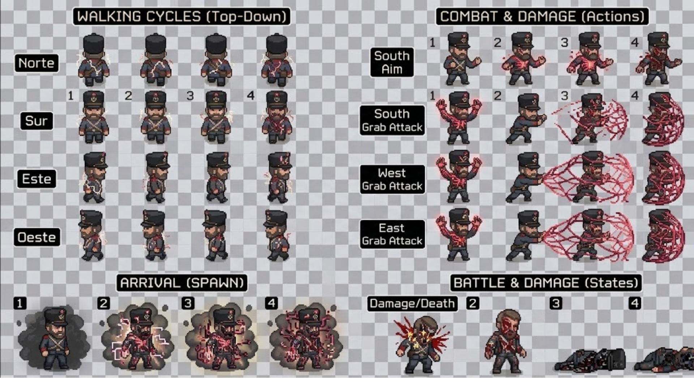
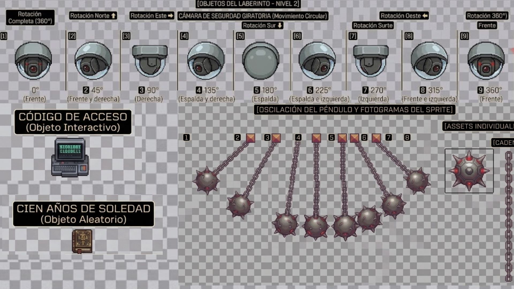

# Operación Macondo

## Momento II: Análisis y diseño de la capa lógica

### 1. Contexto general del videojuego

*Operación Macondo: Terminator en busca de Gabriel García Márquez* es un videojuego que combina elementos de ciencia ficción con la historia y la literatura colombianas. La propuesta integra al personaje de Terminator con el universo literario de Gabriel García Márquez, tomando como referencia la importancia cultural de su obra y la obtención del Premio Nobel de Literatura en 1982.

La historia comienza cuando Skynet intenta alterar el curso de los acontecimientos para impedir que Gabriel García Márquez reciba el Premio Nobel de Literatura. Para cumplir esta misión, Terminator deberá recorrer escenarios inspirados en la costa Caribe colombiana, llegar a Macondo y enfrentarse a los obstáculos y enemigos enviados por Skynet.

Para consultar la narración y la descripción de los niveles, visita la carpeta [**Momento I — Contexto y Niveles**](./momento-i/).

El objetivo final consiste en rescatar a Gabriel García Márquez y permitir que llegue a salvo para recibir el Premio Nobel.

### 2. Diagrama de clases

El siguiente diagrama representa la estructura de clases del videojuego *Operación Macondo*, incluyendo sus principales clases, atributos, métodos y relaciones.

[Ver documento PDF original](./momento-ii/Desafio2.pdf)

### 2. Niveles.
En esta sección se presentan los sprites correspondientes a cada uno de los niveles del videojuego Operación Macondo: Terminator en busca de Gabriel García Márquez. Para el *nivel 1*, se incluyen los sprites de los dos personajes principales: *Terminator*, controlado por el jugador, y el *Hombre con alas enormes*, que actúa como agente enemigo (villano principal del nivel). Además, se muestran dos fondos que representan los escenarios por los que transcurre el recorrido en motocicleta, *Macondo y Santa Marta*. Para el *nivel 2*, se presentarán los sprites de los personajes, enemigos y objetos necesarios para representar el laberinto de Macondo y las mecánicas de exploración, persecución y rescate de Gabriel García Márquez.

#### 2.1 Nivel 1.

#### 2.2 Nivel 2.

